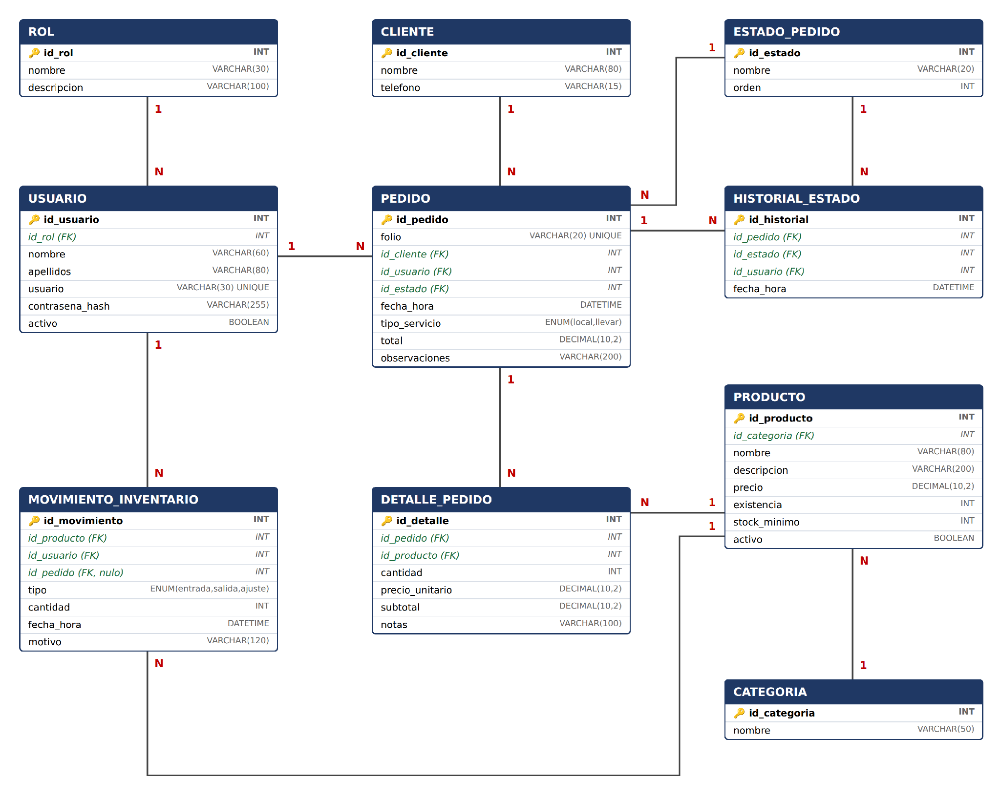

# Sistema de pedidos e inventario para un local de comida

Proyecto 2 de la materia **Implementación de Sistemas** — UNAM, Facultad de Contaduría y Administración, Licenciatura en Informática.
Quinto semestre · Grupo 1592 · **Equipo N.º 11**.

Sistema para organizar y controlar el proceso de pedidos de un establecimiento de comida: desde el registro de los productos y sus existencias hasta la entrega del pedido al cliente. Cada pedido recibe un folio único (`PED-0001`, `PED-0002`, …), pasa por los estados **Recibido → En preparación → Listo → Entregado** (o **Cancelado**) y el inventario se mantiene actualizado de forma automática.

## Integrantes

| N.º | Nombre |
|:---:|---|
| 1 | Cédric Ulises Chávez Rodríguez |
| 2 | Ángel Cédric Solano Reveles |
| 3 | José Ángel Soriano Aguilar |

## Contenido del repositorio

```
.
├── README.md                         ← este archivo
├── LICENSE                           ← licencia MIT
├── .gitignore                        ← archivos que Git no debe subir
├── database/
│   ├── sistema_pedidos.sql           ← crea la base de datos vacía (solo catálogos)
│   └── sistema_pedidos_datos.sql     ← crea la base de datos con datos de prueba
└── docs/
    ├── requerimientos.md             ← planeación: problemática, reglas, requisitos y diagramas
    ├── casos-de-prueba.md            ← datos de prueba y 28 casos de prueba
    └── img/
        ├── diagrama-entidad-relacion.png
        └── panel-administrativo.png
```

## Documentación

- 📄 [Requerimientos y planeación](docs/requerimientos.md): problemática, objetivos, alcances, 27 reglas de negocio, 43 requisitos funcionales, diagrama entidad-relación y panel administrativo.
- 🧪 [Datos y casos de prueba](docs/casos-de-prueba.md): qué datos de ejemplo se cargan y cómo comprobar, paso a paso, que la base de datos funciona.

## Base de datos

La base de datos `sistema_pedidos` reproduce exactamente el diagrama entidad-relación del documento de planeación: **10 tablas**, todas con motor InnoDB y juego de caracteres `utf8mb4`.



| Tabla | Qué guarda |
|---|---|
| `rol` | Tipos de usuario: Administrador, Cajero/Mesero, Cocina. |
| `usuario` | Empleados que usan el sistema. |
| `cliente` | Personas que hacen pedidos (registro opcional). |
| `estado_pedido` | Catálogo de estados del pedido y su orden. |
| `categoria` | Agrupación de productos. |
| `producto` | Artículos a la venta, con precio, existencia y existencia mínima. |
| `pedido` | Órdenes con folio, estado actual, tipo de servicio y total. |
| `detalle_pedido` | Productos de cada pedido, con cantidad, precio unitario y subtotal. |
| `historial_estado` | Cada cambio de estado: quién lo hizo y cuándo. |
| `movimiento_inventario` | Entradas, salidas y ajustes de existencias. |

Los scripts funcionan en **XAMPP (MariaDB)**, en **MySQL 8** y en **MySQL Workbench** sin modificaciones. Además, la propia base de datos rechaza datos incorrectos: folios repetidos (RN-01), cantidades menores a 1 (RN-03), existencias negativas (RN-06), subtotales mal calculados (RN-14), precios de cero (RN-16) y el borrado de registros que tienen información relacionada (RN-21).

## Requisitos

- **Ubuntu** con **[XAMPP](https://www.apachefriends.org/es/index.html)** instalado en `/opt/lampp`.
- XAMPP incluye **MariaDB** (motor de base de datos compatible con MySQL) y **phpMyAdmin** (página web para administrarla).
- Opcional: **[MySQL Workbench](https://dev.mysql.com/downloads/workbench/)**, si prefieres un programa de escritorio en lugar de phpMyAdmin. Los scripts también funcionan con **MySQL 8**.

## Instalación

> [!WARNING]
> Los dos scripts **borran la base de datos `sistema_pedidos` si ya existe** y la crean de nuevo. Todo lo que se haya capturado antes se pierde.

### ¿Qué script uso?

| Script | Úsalo para |
|---|---|
| `database/sistema_pedidos.sql` | Empezar "en limpio": crea las tablas, los 3 roles, los 5 estados y el cliente "Público en general / Mostrador". |
| `database/sistema_pedidos_datos.sql` | Desarrollar y hacer pruebas: misma estructura, más usuarios, productos, 19 pedidos, historial y movimientos de inventario. |

### Paso 1. Descargar el proyecto

Descarga el repositorio con el botón verde **Code → Download ZIP** y descomprímelo, o clónalo con Git:

```bash
git clone <URL-del-repositorio>
```

### Paso 2. Encender XAMPP

Abre una terminal (`Ctrl` + `Alt` + `T`) y ejecuta (te pedirá tu contraseña de Ubuntu):

```bash
sudo /opt/lampp/lampp start
```

Debe indicar que **Apache** y **MySQL** se iniciaron.

### Paso 3, opción A: importar con phpMyAdmin (recomendada)

1. Abre el navegador y entra a <http://localhost/phpmyadmin>.
2. Haz clic en la pestaña **Importar**.
3. Pulsa **Seleccionar archivo** y elige el script que quieras usar (carpeta `database/`).
4. Deja las demás opciones como están (formato **SQL**).
5. Baja hasta el final y pulsa **Importar** (o **Continuar**).
6. Debe aparecer el mensaje *"La importación se ejecutó exitosamente"* y, en el panel izquierdo, la base de datos **sistema_pedidos**.

### Paso 3, opción B: importar desde la terminal

Entra a la carpeta del proyecto y ejecuta el script con el cliente de MariaDB que trae XAMPP:

```bash
cd ruta/del/proyecto
sudo /opt/lampp/bin/mysql -u root < database/sistema_pedidos_datos.sql
```

Si no aparece ningún mensaje, todo salió bien. Si tu usuario `root` tiene contraseña, agrega `-p` después de `root`.

### Paso 3, opción C: ejecutar con MySQL Workbench

Los scripts funcionan en Workbench **sin ninguna modificación**, tanto conectado al MariaDB de XAMPP como a un servidor MySQL 8.

1. Abre Workbench y entra a tu conexión (por ejemplo, *Local instance*, usuario `root`).
2. Ve al menú **File → Open SQL Script…** y elige el script de la carpeta `database/`.
3. Pulsa el **rayo sin cursor** ⚡ (**Execute all**), que ejecuta **todo** el archivo.
   > No uses `Ctrl` + `Enter`: ese atajo ejecuta solo la instrucción donde está el cursor.
4. Revisa el panel **Output** (abajo): todas las líneas deben tener una palomita verde ✔.
5. En el panel izquierdo **Schemas**, pulsa el ícono de recargar 🔄 para que aparezca `sistema_pedidos`.

> [!NOTE]
> **Aviso al conectarte al MySQL de XAMPP.** XAMPP en realidad trae MariaDB, por lo que Workbench puede mostrar el aviso *"Incompatible/nonstandard server version"*. Pulsa **Continue Anyway**: los scripts funcionan igual.

### Paso 4. Comprobar la instalación

En phpMyAdmin, selecciona **sistema_pedidos**, abre la pestaña **SQL** y ejecuta:

```sql
SHOW TABLES;
```

Deben aparecer **10 tablas**. Para revisar a fondo que todo funciona, sigue los [casos de prueba](docs/casos-de-prueba.md).

> En **Workbench**, haz doble clic en `sistema_pedidos` en el panel **Schemas** (para que quede en negritas), escribe `SHOW TABLES;` en una pestaña de consultas y ejecútala con el rayo ⚡.

### Acentos y la letra ñ

Al inicio de cada script está la instrucción `SET NAMES utf8mb4;`. Le indica al servidor que el archivo está guardado en **UTF-8**, para que los acentos y la ñ se guarden correctamente **sin importar el programa** con que se ejecute (phpMyAdmin, Workbench o la terminal). Sin ella, en algunas computadoras "En preparación" podría guardarse como "En preparación".

### Diferencias entre XAMPP (MariaDB) y MySQL 8

| Aspecto | XAMPP (MariaDB) | MySQL 8 / Workbench |
|---|---|---|
| Estructura, datos y validaciones | ✔ Iguales | ✔ Iguales |
| Resultados de los casos de prueba | ✔ Iguales | ✔ Iguales |
| Mensaje cuando se viola una validación | ``CONSTRAINT `chk_producto_precio` failed`` | `Check constraint 'chk_producto_precio' is violated.` |
| Mensaje de folio repetido | `Duplicate entry 'PED-0001' for key 'uq_pedido_folio'` | `Duplicate entry 'PED-0001' for key 'pedido.uq_pedido_folio'` |

### Problemas frecuentes

| Problema | Causa probable | Solución |
|---|---|---|
| phpMyAdmin no abre | XAMPP está apagado. | Ejecuta `sudo /opt/lampp/lampp start`. |
| *"MySQL server has gone away"* o error de tamaño | El archivo supera el límite de importación de phpMyAdmin. | Usa la opción B (terminal). |
| *"Access denied for user root"* | El usuario `root` tiene contraseña. | Agrega `-p` al comando o inicia sesión en phpMyAdmin con esa contraseña. |
| *"CONSTRAINT … failed"* o *"Check constraint … is violated"* al importar | Se editó el script y algún dato no cumple una validación. | Descarga de nuevo el script original. |
| Los acentos se ven como `ó` o `ñ` | Se usó una versión anterior del script, sin `SET NAMES utf8mb4;`. | Descarga la versión actual y vuelve a importarla. |
| Workbench solo creó una parte de las tablas | Se ejecutó con `Ctrl` + `Enter` (una sola instrucción). | Ejecuta con el rayo ⚡ **Execute all**. |
| Workbench avisa *"Incompatible/nonstandard server version"* | Te conectaste al MariaDB de XAMPP. | Pulsa **Continue Anyway**. |
| `sistema_pedidos` no aparece en Workbench | El panel Schemas no se ha actualizado. | Pulsa el ícono de recargar 🔄 en **Schemas**. |

## Usuarios de prueba

Solo existen si se importó `sistema_pedidos_datos.sql`. Todos tienen la contraseña **`Prueba123`** (guardada cifrada con bcrypt, compatible con `password_verify()` de PHP).

| Usuario | Rol | Estado |
|---|---|:---:|
| `admin` | Administrador | Activo |
| `jperez`, `mlopez` | Cajero/Mesero | Activo |
| `rramirez`, `agarcia` | Cocina | Activo |
| `rtorres` | Cajero/Mesero | Inactivo (para probar el bloqueo de acceso) |

> [!CAUTION]
> Estas cuentas son solo para pruebas. No las uses en un entorno real.

## Estado del proyecto

- [x] Planeación y requerimientos
- [x] Diseño de la base de datos (diagrama entidad-relación)
- [x] Scripts de creación de la base de datos y datos de prueba
- [x] Casos de prueba de la base de datos
- [ ] Aplicación (panel administrativo, pedidos, inventario y reportes)

## Licencia

Este proyecto se distribuye bajo la licencia MIT. Consulta el archivo [LICENSE](LICENSE).
