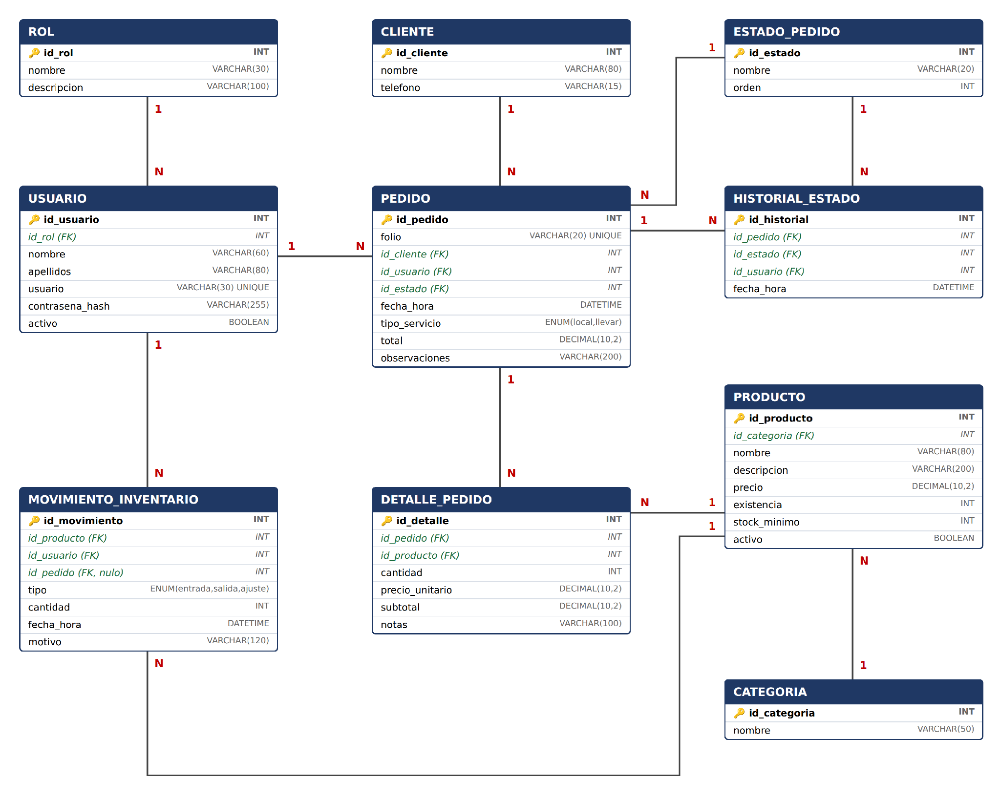

# Sistema de pedidos e inventario para un local de comida

Proyecto 2 de la materia **Implementación de Sistemas** — UNAM, Facultad de Contaduría y Administración, Licenciatura en Informática.
Quinto semestre · Grupo 1592 · **Equipo N.º 11**.

Sistema para organizar y controlar el proceso de pedidos de un establecimiento de comida: desde el registro de los productos y sus existencias hasta la entrega del pedido al cliente. Cada pedido recibe un folio único (`PED-0001`, `PED-0002`, …), pasa por los estados **Recibido → En preparación → Listo → Entregado** (o **Cancelado**) y el inventario se mantiene actualizado de forma automática.

## Integrantes

| N.º | Nombre |
|:---:|---|
| 1 | Cédric Ulises Chávez Rodríguez |
| 2 | Ángel Cédric Solano Reveles |
| 3 | José Ángel Soriano Aguilar |

## Tecnologías

| Herramienta | Versión | Para qué se usa |
|---|---|---|
| [Laravel](https://laravel.com) | 13.x | Framework de PHP: migraciones, modelos y datos de prueba. |
| [Filament](https://filamentphp.com) | 5.x | Panel administrativo: recursos, formularios y tablas (CRUD). |
| PHP | 8.4 o superior | Lenguaje en el que está hecho Laravel. |
| [Composer](https://getcomposer.org) | 2.x | Descarga las librerías que necesita Laravel. |
| [Laravel Herd](https://herd.laravel.com) (Windows) | 1.x | Trae PHP y Composer; con **SQLite** como base de datos. Es lo que se usa en la escuela. |
| XAMPP (MariaDB) (Ubuntu) | 8.2 o superior | Servidor de base de datos y phpMyAdmin. |

El proyecto funciona igual con **SQLite** (Herd en Windows) y con **MySQL/MariaDB** (XAMPP).

## Contenido del repositorio

Este repositorio es un proyecto **Laravel**. Las carpetas más importantes para la base de datos son:

```
.
├── app/
│   ├── Filament/               ← panel administrativo: recursos, inicio de sesión y botones
│   ├── Models/                 ← 10 modelos con sus relaciones (Eloquent)
│   └── Services/               ← reglas de negocio de los pedidos (PedidoService)
├── database/
│   ├── migrations/             ← 10 migraciones del diagrama + 3 de la Evaluación 1
│   ├── seeders/                ← datos de prueba (8 seeders)
│   └── sql/                    ← scripts SQL equivalentes (alternativa sin Laravel)
├── docs/
│   ├── requerimientos.md       ← planeación: problemática, reglas, requisitos y diagramas
│   ├── casos-de-prueba.md      ← datos de prueba y 28 casos de prueba
│   └── img/                    ← diagrama entidad-relación y panel administrativo
├── lang/es/                    ← mensajes de validación en español
├── .env.example                ← configuración de ejemplo (ya apunta a XAMPP)
└── README.md                   ← este archivo
```

## Documentación

- 📄 [Requerimientos y planeación](docs/requerimientos.md): problemática, objetivos, alcances, 27 reglas de negocio, 43 requisitos funcionales, diagrama entidad-relación y panel administrativo.
- 🧪 [Datos y casos de prueba](docs/casos-de-prueba.md): qué datos de ejemplo se cargan y cómo comprobar, paso a paso, que la base de datos funciona.

## Base de datos

La base de datos `sistema_pedidos` reproduce exactamente el diagrama entidad-relación del documento de planeación: **10 tablas** con los mismos nombres, campos, tipos de dato y relaciones.



### Migraciones, modelos y relaciones

| Tabla | Migración | Modelo | Relaciones del modelo |
|---|---|---|---|
| `rol` | `..._000001_create_rol_table.php` | `Rol` | `usuarios()` |
| `usuario` | `..._000002_create_usuario_table.php` | `Usuario` | `rol()`, `pedidos()`, `historialEstados()`, `movimientos()` |
| `cliente` | `..._000003_create_cliente_table.php` | `Cliente` | `pedidos()` |
| `estado_pedido` | `..._000004_create_estado_pedido_table.php` | `EstadoPedido` | `pedidos()`, `historial()` |
| `categoria` | `..._000005_create_categoria_table.php` | `Categoria` | `productos()` |
| `producto` | `..._000006_create_producto_table.php` | `Producto` | `categoria()`, `detalles()`, `pedidos()`, `movimientos()` |
| `pedido` | `..._000007_create_pedido_table.php` | `Pedido` | `cliente()`, `usuario()`, `estado()`, `detalles()`, `productos()`, `historial()`, `movimientos()` |
| `detalle_pedido` | `..._000008_create_detalle_pedido_table.php` | `DetallePedido` | `pedido()`, `producto()` |
| `historial_estado` | `..._000009_create_historial_estado_table.php` | `HistorialEstado` | `pedido()`, `estado()`, `usuario()` |
| `movimiento_inventario` | `..._000010_create_movimiento_inventario_table.php` | `MovimientoInventario` | `producto()`, `usuario()`, `pedido()` |

- Las relaciones **1 : N** del diagrama se programaron con `hasMany()` (lado "uno") y `belongsTo()` (lado "muchos").
- La relación **N : M** entre `Pedido` y `Producto` se resuelve con `detalle_pedido` y se programó con `belongsToMany()`.
- Además, la base de datos rechaza datos incorrectos con restricciones `CHECK`, `UNIQUE` y llaves foráneas: folios repetidos (RN-01), cantidades menores a 1 (RN-03), existencias negativas (RN-06), subtotales mal calculados (RN-14), precios de cero (RN-16) y el borrado de registros con información relacionada (RN-21).

## Panel administrativo (Filament 5)

Se entra en `/admin` con un usuario de la tabla `usuario` (ver [Usuarios de prueba](#usuarios-de-prueba)). Solo los usuarios **activos** pueden entrar (RN-24).

| Recurso | Formulario | Tabla | Botones especiales |
|---|---|---|---|
| **Categorías** | Nombre, activa | Nombre, número de productos, activa; filtro por estado | Desactivar / Activar |
| **Productos** | Nombre, categoría, descripción, precio, existencia, mínimo, activo | Precio en pesos, existencia con colores (agotado / stock bajo), filtros por categoría, estado y stock bajo | Desactivar / Activar |
| **Clientes** | Nombre, teléfono, activo | Nombre, teléfono, número de pedidos; filtro por estado | Desactivar / Activar |
| **Pedidos** | Cliente, tipo de servicio, observaciones y productos con cantidades | Folio, fecha, cliente, estado con colores, servicio, total; filtros por estado, servicio y fecha | Pasar al siguiente estado, Cancelar (con motivo) |

- **Eliminar = desactivar**: los registros no se borran; se marcan como inactivos para conservar el historial (RN-21).
- **Pedidos**: el sistema genera el folio `PED-####`, copia el precio del menú, calcula el total, valida y descuenta existencias, y guarda el historial de estados. Al cancelar, las existencias regresan al inventario.
- **Validaciones**: los formularios repiten las reglas de la base de datos (precio mayor que 0, cantidad de al menos 1, existencia no negativa), así se cumplen también en SQLite.
- **Cambios a la base de datos (Evaluación 1)**: campo `activo` en `categoria` (RF-10) y `cliente`, y campo `motivo_cancelacion` en `pedido` (RF-31).

### Funciones completas de la planeación

| Pantalla (menú) | Qué hace | Requisitos y reglas |
|---|---|---|
| **Escritorio** | Indicadores del día: pedidos, por preparar, listos, ventas y stock bajo; tabla de productos por resurtir; gráfica de ventas de 7 días | RF-38, RF-21 |
| **Tablero de cocina** | Pedidos activos en tres columnas (Recibido, En preparación, Listo), con tiempo de espera; se actualiza solo cada 15 s | RF-36, RF-37 |
| **Pedidos** | Registrar (buscar cliente por nombre o teléfono, botón + para cliente nuevo), modificar productos mientras está en "Recibido", comprobante para imprimir, tiempo de espera, filtros por estado, fecha, cliente y servicio | RF-23 a RF-37, RN-01 a RN-15, RN-26, RN-27 |
| **Productos** | Botones **Registrar entrada** (resurtido) y **Ajustar existencia** (merma o conteo, con motivo); movimientos de cada producto; número rojo en el menú con los productos en stock bajo | RF-16, RF-17, RF-20, RF-21, RN-20, RN-22, RN-23 |
| **Movimientos de inventario** | Historial de entradas, salidas y ajustes, con filtros por producto, tipo, fecha y usuario | RF-22 |
| **Reportes** | Ventas por día o periodo, productos más vendidos, pedidos por estado e inventario por resurtir (en pantalla) | RF-39 a RF-42 |
| **Usuarios** | Alta, consulta, edición, rol y desactivar empleados | RF-04 a RF-07 |
| **Configuración** | Nombre del negocio y horario de servicio (por defecto 8:00 a 22:00) | RN-27 |
| **Cambiar contraseña** (menú del usuario, arriba a la derecha) | Cada usuario cambia su contraseña escribiendo la actual | RF-08 |

**Permisos por rol (RN-25, RF-03)** — el menú y los botones cambian según el rol:

| Función | Administrador | Cajero/Mesero | Cocina |
|---|:---:|:---:|:---:|
| Registrar, modificar y cancelar pedidos | ✔ | ✔ | — |
| Pasar a "En preparación" y "Listo" | ✔ | — | ✔ |
| Entregar pedidos ("Listo" → "Entregado") | ✔ | ✔ | — |
| Ver pedidos y tablero de cocina | ✔ | ✔ | ✔ |
| Registrar y editar clientes | ✔ | ✔ | — |
| Consultar productos | ✔ | ✔ | — |
| Categorías, productos (editar), entradas y ajustes | ✔ | — | — |
| Movimientos, reportes, usuarios y configuración | ✔ | — | — |

Los permisos están en `app/Policies`. Las reglas de pedidos e inventario están en `app/Services/PedidoService.php` e `app/Services/InventarioService.php`.

- **Cambio a la base de datos**: tabla nueva `configuracion` (nombre del negocio y horario de servicio). Después de descargar los cambios hay que ejecutar `php artisan migrate`.
- **Pruebas automáticas**: `php artisan test` revisa las reglas de negocio y las pantallas (32 pruebas, usan una base temporal y no tocan los datos).

## Instalación en Windows con Laravel Herd (SQLite)

Requisitos: [Laravel Herd](https://herd.laravel.com/windows) con **PHP 8.4 o superior** y [Git para Windows](https://git-scm.com/download/win). Los comandos se escriben en **PowerShell**.

```powershell
cd $HOME\Herd
git clone https://github.com/Angeltron10000/sistema-pedidos-inventario.git
cd sistema-pedidos-inventario
composer install
Copy-Item .env.example .env
php artisan key:generate
```

Abre el archivo `.env` con el Bloc de notas (`notepad .env`) y deja así la parte de la base de datos:

```ini
DB_CONNECTION=sqlite
# DB_HOST=127.0.0.1
# DB_PORT=3306
# DB_DATABASE=sistema_pedidos
# DB_USERNAME=root
# DB_PASSWORD=
```

Después crea las tablas con los datos de prueba (responde **yes** si pregunta si quieres crear el archivo de SQLite):

```powershell
php artisan migrate:fresh --seed
```

Abre en el navegador **http://sistema-pedidos-inventario.test/admin** y entra con `admin` / `Prueba123`.

## Instalación (Ubuntu + XAMPP)

> [!NOTE]
> Los comandos se escriben en una **terminal** (`Ctrl` + `Alt` + `T`). Los que empiezan con `sudo` piden tu contraseña de Ubuntu.

### 1. Encender XAMPP

```bash
sudo /opt/lampp/lampp start
```

### 2. Instalar PHP, Composer y Git (solo la primera vez)

El proyecto necesita **PHP 8.4 o superior** (sus librerías, como Symfony 8, ya no funcionan con PHP 8.3). Ubuntu 24.04 y 22.04 traen una versión anterior, así que primero se agrega el repositorio con PHP actualizado:

```bash
sudo add-apt-repository ppa:ondrej/php -y && sudo apt update
sudo apt install -y php8.4-cli php8.4-mysql php8.4-sqlite3 php8.4-xml php8.4-mbstring php8.4-curl php8.4-zip php8.4-bcmath php8.4-intl unzip git composer
sudo update-alternatives --set php /usr/bin/php8.4
```

Comprueba las versiones:

```bash
php -v          # debe decir PHP 8.4 o superior
composer -V
git --version
```

### 3. Descargar el proyecto e instalar sus librerías

```bash
cd ~
git clone https://github.com/Angeltron10000/sistema-pedidos-inventario.git
cd sistema-pedidos-inventario
composer install
```

### 4. Configurar el proyecto

```bash
cp .env.example .env
php artisan key:generate
```

El archivo `.env` ya viene configurado para el MariaDB de XAMPP:

```ini
DB_CONNECTION=mysql
DB_HOST=127.0.0.1
DB_PORT=3306
DB_DATABASE=sistema_pedidos
DB_USERNAME=root
DB_PASSWORD=
```

Si tu usuario `root` tiene contraseña, escríbela en `DB_PASSWORD`.

### 5. Crear la base de datos

En phpMyAdmin (<http://localhost/phpmyadmin>) → **Nueva** → nombre `sistema_pedidos`, cotejamiento `utf8mb4_unicode_ci` → **Crear**.

> También puedes saltarte este paso: al ejecutar las migraciones, Laravel pregunta si quieres crear la base de datos; responde **yes**.

### 6. Ejecutar las migraciones y cargar los datos de prueba

> [!IMPORTANT]
> Si **antes importaste el script SQL** (`database/sql/…`) en `sistema_pedidos`, primero borra esas tablas. Si no, las migraciones fallan con *"Table 'rol' already exists"*:
> ```bash
> php artisan db:wipe
> ```

```bash
php artisan migrate --seed
```

Esto crea las 10 tablas y las llena con: 3 roles, 5 estados, 5 clientes, 6 usuarios, 6 categorías, 21 productos, 19 pedidos con su detalle e historial y 82 movimientos de inventario.

Para **borrar todo y volver a empezar** con los datos originales:

```bash
php artisan migrate:fresh --seed
```

### 7. Comprobar

```bash
php artisan migrate:status
```

Deben aparecer las 13 migraciones con estado **Ran**. Después abre phpMyAdmin y revisa las tablas de `sistema_pedidos`. Para pruebas más completas, sigue los [casos de prueba](docs/casos-de-prueba.md).

Para abrir el panel administrativo:

```bash
php artisan serve
```

y entra a **http://127.0.0.1:8000/admin** con `admin` / `Prueba123`.

### Probar las relaciones con Tinker

Tinker es una consola de Laravel para usar los modelos directamente:

```bash
php artisan tinker
```

```php
$p = App\Models\Pedido::where('folio', 'PED-0014')->first();
$p->cliente->nombre;                 // "Ana Torres"
$p->estado->nombre;                  // "Listo"
$p->productos->pluck('nombre');      // Queso fundido, Arrachera con guarnición, Refresco
App\Models\Producto::stockBajo()->pluck('nombre');   // Molletes, Queso fundido, Malteada de vainilla
```

Escribe `exit` para salir.

### Problemas frecuentes

| Problema | Solución |
|---|---|
| `could not find driver` | Falta la extensión de MySQL para PHP: `sudo apt install php8.4-mysql`. |
| `SQLSTATE[HY000] [2002] Connection refused` | XAMPP está apagado: `sudo /opt/lampp/lampp start`. |
| `Access denied for user 'root'` | Escribe la contraseña de `root` en `DB_PASSWORD` del archivo `.env`. |
| `Your PHP version does not satisfy that requirement` | Tu PHP es anterior a 8.4; repite el paso 2. En Windows, elige PHP 8.4 en Laravel Herd. |
| `Base table or view already exists` | Ya existían tablas creadas con el script SQL. Ejecuta `php artisan db:wipe` y luego `php artisan migrate --seed`. |
| `Unknown database 'sistema_pedidos'` | No se creó la base de datos. Créala en phpMyAdmin (paso 5) o ejecuta `php artisan migrate` sin `--seed` y responde **yes** cuando pregunte si quieres crearla. |

## Alternativa sin Laravel: scripts SQL

En `database/sql/` están los scripts que crean exactamente la misma base de datos sin usar Laravel:

| Script | Contenido |
|---|---|
| `sistema_pedidos.sql` | Tablas y catálogos básicos. |
| `sistema_pedidos_datos.sql` | Tablas y todos los datos de prueba. |

Se pueden importar en **phpMyAdmin** (pestaña **Importar**), en **MySQL Workbench** (**File → Open SQL Script** y el rayo ⚡ **Execute all**) o desde la terminal:

```bash
sudo /opt/lampp/bin/mysql -u root < database/sql/sistema_pedidos_datos.sql
```

> [!WARNING]
> Los scripts **borran la base de datos `sistema_pedidos` si ya existe**. Funcionan en XAMPP (MariaDB) y en MySQL 8; solo cambia el texto de algunos mensajes de error (ver [casos de prueba](docs/casos-de-prueba.md)).

## Usuarios de prueba

Todos tienen la contraseña **`Prueba123`** (guardada cifrada con bcrypt).

| Usuario | Rol | Estado |
|---|---|:---:|
| `admin` | Administrador | Activo |
| `jperez`, `mlopez` | Cajero/Mesero | Activo |
| `rramirez`, `agarcia` | Cocina | Activo |
| `rtorres` | Cajero/Mesero | Inactivo (para probar el bloqueo de acceso) |

> [!CAUTION]
> Estas cuentas son solo para pruebas. No las uses en un entorno real.

## Estado del proyecto

- [x] Planeación y requerimientos
- [x] Diseño de la base de datos (diagrama entidad-relación)
- [x] Scripts SQL y casos de prueba
- [x] Migraciones, modelos con relaciones y datos de prueba en Laravel
- [x] Panel administrativo con Filament 5: recursos y CRUD de categorías, productos, clientes y pedidos (Evaluación 1)
- [x] Usuarios, movimientos de inventario, permisos por rol, tablero de cocina, indicadores y reportes (todas las funciones de la planeación)

## Licencia

Este proyecto se distribuye bajo la licencia MIT. Consulta el archivo [LICENSE](LICENSE).
